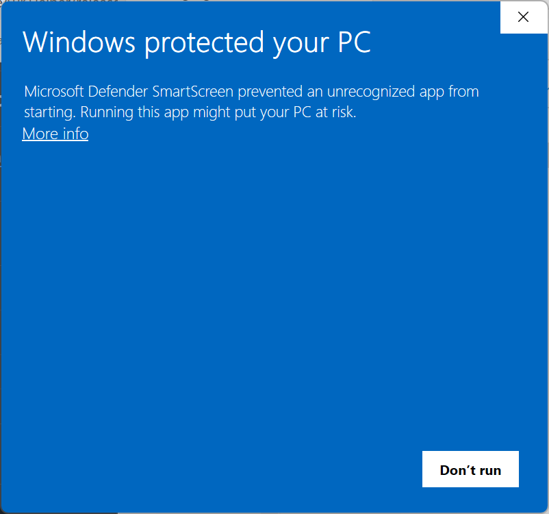
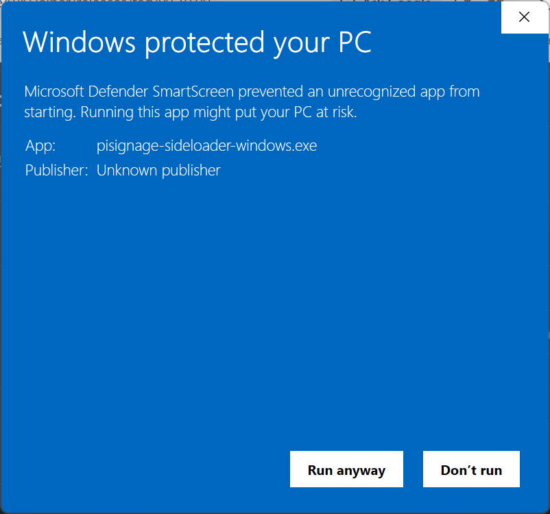
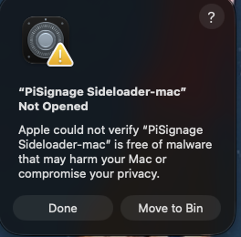
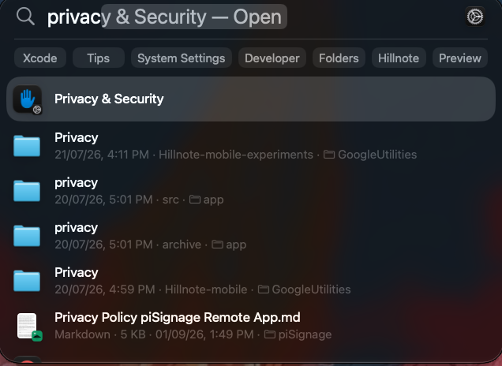
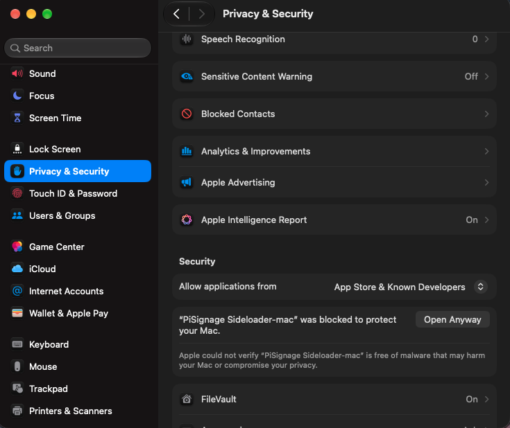
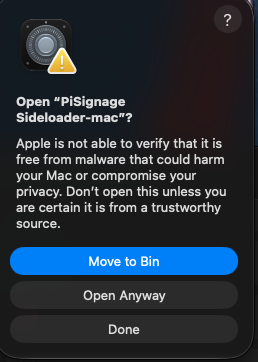

# PiSignage Sideloader

Finds Android devices with wireless debugging enabled on the local network and installs the PiSignage player APK onto android device. 

## How to enable side loading:

The sideloader finds devices over ADB wireless debugging, so each Android
device must have it turned on:

1. Enable Developer options: open **Settings → About phone** (on some devices
  **About tablet** / **About device**) and tap **Build number** seven times.
2. Go to **Settings → System → Developer options** (on some devices it's
  directly under Settings).
3. Turn on **Wireless debugging**. Confirm the prompt to allow it on the
  current Wi-Fi network.
4. Make sure the device is on the **same Wi-Fi network** as the computer
  running the sideloader.
5. On Android 11+, the first connection from a new computer needs pairing:
  tap **Wireless debugging → Pair device with pairing code** and enter the
   shown code/IP/port when the sideloader asks.

> [!WARNING]
> On **_Android 10 and below_**, the Wireless debugging toggle isn’t available, so this solution won’t work on those versions.

## Running on Windows (first launch)

The Windows executable is not code-signed, so the first time you run it
Microsoft Defender SmartScreen blocks it with a **"Windows protected your PC"**
dialog. To allow it:

1. Click **More info** in the dialog.

   

2. Check that the App is `pisignage-sideloader-windows.exe`, then click
   **Run anyway**.

   

You only need to do this once per copy of the exe. If the dialog shows no
**More info** link, right-click the exe → **Properties**, tick **Unblock** at
the bottom of the General tab, click **OK**, and run it again.

## Running on Mac (first launch)

The Mac app is not signed with an Apple Developer ID certificate and has not
been notarized by Apple. macOS Gatekeeper only opens downloaded apps that are
both, so on first launch it can't verify where the app came from and refuses
to open it. The dialog offers no way to open it from there; you have to grant
an exception in System Settings, which is what steps 2–4 do.

1. Unzip the download and open **PiSignage Sideloader-mac**. macOS shows a
   **"PiSignage Sideloader-mac" Not Opened** dialog. Click **Done** (not
   **Move to Bin**).

   

2. Open **System Settings → Privacy & Security** (or search for "Privacy &
   Security" with Spotlight). This is where macOS lists apps Gatekeeper has
   just blocked.

   

3. Scroll to the **Security** section at the bottom. You'll see
   **"PiSignage Sideloader-mac" was blocked to protect your Mac.** Click
   **Open Anyway**. The button only appears for about an hour after the blocked
   launch; if it's missing, open the app again and come back.

   

4. macOS asks once more to confirm. Click **Open Anyway** and enter your
   password or use Touch ID if prompted. This records a permanent exception
   for this copy of the app.

   

You only need to do this once. After that the app opens normally with a
double-click. A newly downloaded copy (e.g. an update) needs the same steps.

## Building

The build uses Node's SEA, which patches a copy of *this* machine's `node`
binary — so it cannot cross-compile. Build on a Mac for Mac, on Windows for
Windows.

Prerequisites on the build machine:

- Node 20 (pinned in `.nvmrc`; `build.js` refuses other majors since the
build machine's Node is what ships inside the binary)
- Android platform-tools (`adb`), auto-detected from PATH or the usual SDK
spots; override with `ADB_EMBED=/path/to/adb`


### macOS (Apple Silicon)

```sh
node test.js && node build.js
# → dist/PiSignage Sideloader.app
```

For Intel Macs, run `build.js` with an x64 Node (e.g. under Rosetta) — the
output architecture matches the Node that ran the build.

### Windows

```powershell
node test.js; node build.js
# → dist\pisignage-sideloader.exe
```

`adb.exe` needs `AdbWinApi.dll` and `AdbWinUsbApi.dll` beside it; `build.js`
embeds them automatically and warns if they're missing.

Watch the build output: an `adb: embedding ...` line with no `warn:` lines means the binary is fully self-contained.
